  

  

  
  
  

---

  <i>"I don’t do magic—but I <b>do</b> full-stack."</i> 
  <i>From front-end spells to back-end levitation.</i>

---

### 👩‍💻 About Me

Hi! I’m **Aarya**, a software engineer at **Intuit**, working on the **QuickBooks Payroll** backend. I graduated from **Penn State** in May 2026 with a B.S. in Computer Science and a minor in Economics.

- 💼 At Intuit, I work on payroll web services and the processing backend: Kafka consumers, third-party benefits integrations, and a lot of production debugging
- 🤖 Brought AI-powered Playwright automation to my team, cutting manual regression effort by 92.5%
- 🛸 Before Intuit: autonomous drone systems at Aerolens, plus Parkinson’s detection research at Penn State
- 🌱 Currently sharpening: system design, data structures and algorithms, and backend depth in Java and Spring Boot
- 🏅 Proud member of **Tau Beta Pi**

Always happy to chat about backend systems, ML, fintech, or side projects, so feel free to reach out! 😊

---

### 🚀 Top Projects

- 🌿 [**GreenBucks**](https://github.com/arrysoni/GreenBucks): Sustainable-finance platform built at PennApps XXVI. It scores bank transactions by CO2 impact. I built the entire frontend (React, Tailwind CSS, Zustand).
- 🛸 [**Drone Platform**](https://github.com/arrysoni/drone-project-psu-chalmers): Penn State × Chalmers capstone with AstaZero. I worked on the backend: communication framework, telemetry streaming with Redis and WebSockets, and mission control in Python.
- 🧠 [**Regret Prediction Model**](https://github.com/arrysoni/regret-prediction-model): End-to-end ML pipeline predicting post-purchase regret from behavioral and spending features (gradient boosting, 0.78 ROC-AUC on synthetic data).
- 📈 [**Portfolio Optimizer**](https://github.com/arrysoni/AI-Powered-Portfolio-Optimization-Tool): Max-Sharpe portfolio optimization on live market data, deployed on Streamlit. [Try it live](https://ai-powered-portfolio-optimization-tool.streamlit.app/)

---

### 🛠️ Tech Stack

**Backend** 

**Frontend** 

**ML / Data** 

**Tools & Infra** 

---

### 📊 GitHub Stats

  
  

